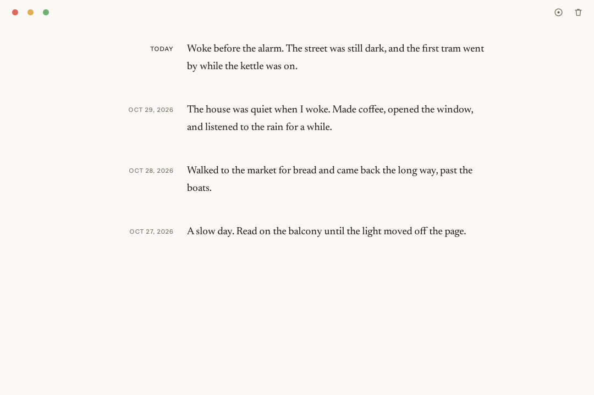

# Pereda

A real-time daily note app for the desktop: one note per day, written as you type. macOS, Windows and Linux, in about 9.5 MB, with no account, no server and no network.



The product is [PRODUCT.md](PRODUCT.md); the architecture is [SYSTEMS.md](SYSTEMS.md); the decisions are in [docs/adrs](docs/adrs/).

## Run it

```sh
tinyjs dev      # the app, with hot reload
bun test        # the store and the day
tinyjs build    # the app for this OS
```

## Release

`.github/workflows/publish.yml` runs on a push to `main`: it reads the version in `tinyjs.json`, builds macOS arm64 and x86_64, Windows and Linux, tags `v<version>` once every build succeeds, and publishes the GitHub release with the four archives. A push that leaves the version alone does nothing ([007](docs/adrs/007-releases-follow-the-version-file.md)).

The macOS build is signed and notarized when these secrets are set, and ad-hoc signed without them: `MACOS_CERTIFICATE`, `MACOS_CERTIFICATE_PASSWORD`, `MACOS_KEYCHAIN_PASSWORD`, `MACOS_SIGN_IDENTITY`, `MACOS_NOTARY_PROFILE`, `MACOS_APPLE_ID`, `MACOS_TEAM_ID`, `MACOS_APP_PASSWORD`.
