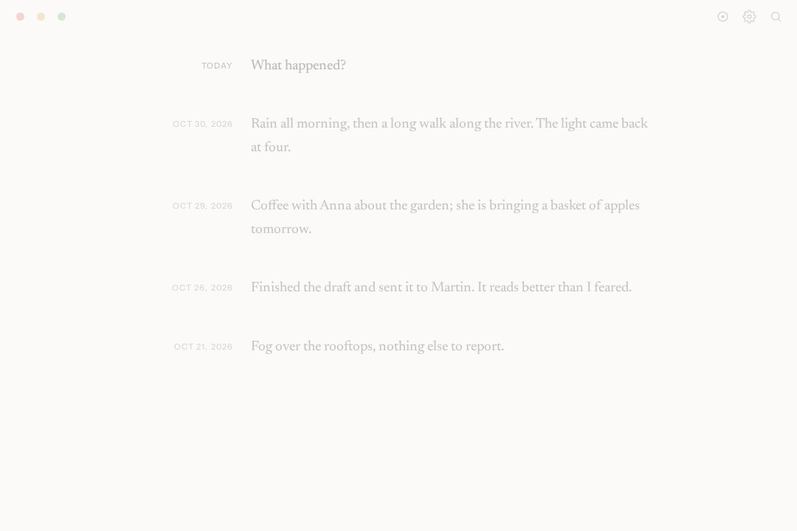

# Pereda

A real-time daily note app: one note per day, written as you type. The desktop app runs on macOS, Windows and Linux; a static web page writes the same log in the browser. The product is [docs/SPEC8N.md](docs/SPEC8N.md) and the design values are [docs/DESIGN.md](docs/DESIGN.md).



## Setup

Bun 1.4.4 or newer.

```sh
bun install
bun run dev
```

## Usage

Run the checks and the builds.

```sh
bun test
bun run build
bun run build:web
```

## License

MIT — see [LICENSE](LICENSE).
