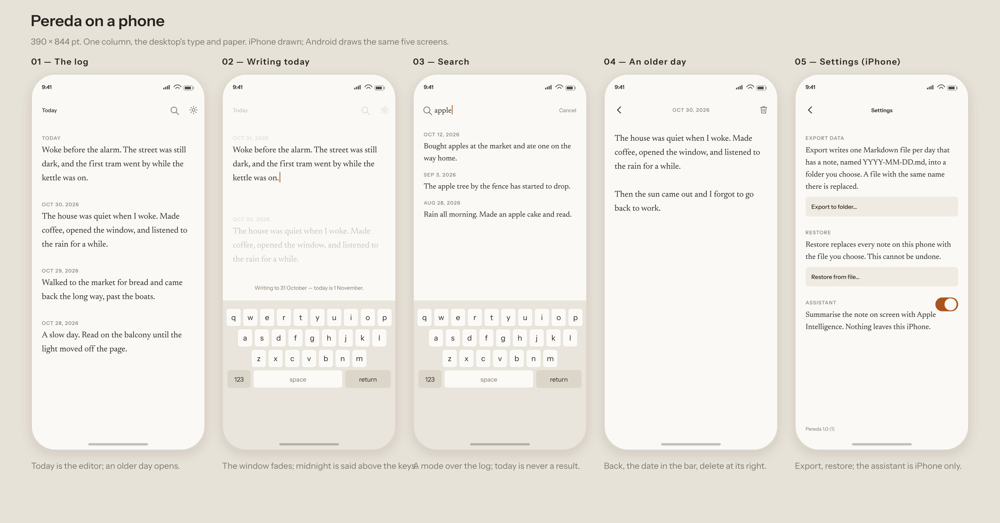

# Pereda: mobile 1.0 — the plan

Two native apps, iPhone and Android, in `apps/iphone` and `apps/android`: the desktop's day, live write, search and export, on a phone. Decided in [`026`](adrs/026-mobile-apps-are-native-on-the-same-store.md) and not built. This file is the specification until they ship; then its behaviour moves into `PRODUCT.md` and its geometry into a design document.



## What both apps keep

- One note per day, written as it is typed; today opens with the caret in it and the keyboard down.
- The store is the desktop's: schema version 2, `notes` and `notes_fts`, `unicode61 remove_diacritics 0`, tombstones, sequence counters, WAL, `synchronous = FULL`.
- No account, no network, no sync. Each device is its own log; export and restore are the only ways notes move.
- Search is a mode, settings a page, export Markdown, delete asks once, a future day cannot be written.
- The type and colour are the desktop's. Note 19 pt Newsreader at 1.65; chrome 11 pt Instrument Sans, uppercase, 0.1 em tracking; paper `#faf9f6` and `#121110`; ink `#26231f` and `#ece7dd`; muted `#7d756a` and `#958d80`; accent `#a9541c` and `#dda36c`; error `#a5342c` and `#e59a92`.
- Geometry: 24 pt side margins, one column, 40 pt between entries, a 44 pt top bar under the safe area, 44 × 44 pt targets. Android reads pt as dp.

## The screens

### The log

The app opens here, on today, at the top.

- The bar holds **Today** at the left as a word (12 pt, medium), search and settings at the right.
- Each entry is a date label above its note: 11 pt, uppercase, muted, 0.1 em, then 4 pt, then the note at 19 pt.
- Today's note is the editor. Every older day with a note follows, full text at full ink, newest first, 30 days a page; scrolling reaches the next page.
- A tap in today's note puts the caret and raises the keyboard; tapping an older entry flushes today and opens that day. Today's entry is always first, empty or not, and has no placeholder.
- While the note has the caret, the bar and every other entry are drawn at 0.25 with a 150 ms transition; the status line is not. Tapping outside the note, or scrolling, dismisses the keyboard and the page returns to full strength.
- Backgrounding flushes at once. A session left open across midnight keeps the day it loaded and says where the text is going until **Today** is pressed; a relaunch opens on today.

### The day

An older day, pushed from the log or a search result. It is the one screen the desktop does not have: on a phone the log cannot be the index and every day's editor at once.

- The bar holds the back control at the left, the date at 11 pt muted and centred, delete at the right. There is no Today control; back returns to where the day opened: the log at the day it left, or the search results.
- The note fills the page at the log's geometry and writes live. A day with nothing written is not reachable here.
- Delete is a trash glyph, 44 × 44, and asks once: "Delete 30 October 2026? This cannot be undone." Cancel, Delete. Today has no day screen and no delete; clearing its last character removes it.

### Search

Opened from the magnifier; the log is replaced, as on the desktop.

- The bar becomes the field: magnifier, the query at 17 pt Newsreader, and **Cancel** at 12 pt. The field takes focus and the keyboard.
- Results are matching older days, newest first, at most fifty: a date label, then the text around the match at 17 pt over 1.6, 24 pt apart. No ranking, no highlight, no count.
- An empty field stays open with nothing under it. No match says "No note says that."
- A result opens the day screen over the results; back from the day returns to them, query and scroll kept. **Cancel** closes the mode and returns to the log at today.
- A query that is exactly `YYYY-MM-DD` resolves before the word rule. A future day is refused in the status line; a day with no note lands on the newest day at or before it, today included, and the status says so once: "No note on 12 October — showing 10 October."

### Settings

A page pushed from the gear, one column.

- **Export Data**: the folder rule in one sentence at 17 pt, then **Export to folder…**, then the result. One Markdown file per day, `YYYY-MM-DD.md`, verbatim UTF-8, same-named file replaced, count and folder or the first failure named. Files go to a folder chosen in Files (iOS) or with the system tree picker (Android).
- **Restore**: "Restore replaces every note on this phone with the file you choose. This cannot be undone." Then **Restore from file…**, a database picker, and one confirmation: Replace, Cancel. The file is integrity-checked and version-lifted before it is swapped in; a file that fails changes nothing and is named.
- **Assistant** (iPhone only, iOS 26 and later): a switch, off by default, with "Summarise the note on screen with Apple Intelligence. Nothing leaves this iPhone." When the model is unavailable the switch is disabled with the reason. Android has no section.
- The bottom carries `Pereda 1.0 (1)` at 11 pt muted.

### The assistant

An iPhone action, drawn as a sparkle at the right of the bar, before search and settings, only while the switch is on and the model is available. It summarises the note on screen into a bottom sheet marked **GENERATED ON THIS IPHONE**, with Close. One request at a time; the editor stays usable; no word enters the note.

### What is said, where

- The status line is a pill 12 pt, centred, 12 pt above the safe area or the keyboard: error colour for a failure, muted for a fact.
- It carries one message, in the desktop's words: "Not saved — …", "Writing to 31 October — today is 1 November.", the jump notice, the restore result.
- A save that failed outranks every notice; the text stays on screen.
- A database that will not open stops the app on a full-screen page naming the file, as on the desktop.

## The platform split

- **iPhone**: SwiftUI, iOS 18 and later, the system SQLite through a thin C wrapper, the assistant on iOS 26 with Apple Intelligence, the Files folder picker.
- **Android**: Jetpack Compose, Android 10 (API 29) and later, SQLite from `androidx.sqlite:sqlite-bundled`, no Room, the system tree picker, no assistant.
- Both: portrait only in 1.0; the system back gesture and a visible back control close a pushed page; safe-area insets, not a drawn status bar.

## The repository

```
apps/desktop      unchanged
apps/iphone       Pereda.xcodeproj, Sources, Tests, Resources
apps/android      settings.gradle.kts, app, gradle
fixtures/mobile   notes.sqlite, cases.json
```

- The native directories carry no `package.json`, so the root bun workspace, `apps/*`, still resolves to the desktop alone.
- `fixtures/mobile/notes.sqlite` is one schema-2 database: days across a year boundary, å, ä and ö, a tombstone, a note of several paragraphs. `cases.json` holds query → days, and day → body, for both suites.
- Each app has its own build (`xcodebuild`, `./gradlew`); the desktop's release workflow does not build either. Store builds and CI land with the first app code.

## Phases

0. **Contract** — this file, the record and the mockup. No code.
1. **Store spike** — both apps open the fixture read-only, run every case and print identical output on a device and an emulator. This is the only technical risk; a difference in FTS5 or the tokenizer changes the plan before any screen is built.
2. **iPhone 1.0** — log, day, search, settings, export, restore, then the assistant. TestFlight.
3. **Android 1.0** — the same screens against the frozen fixture. Internal testing.
4. **Stores** — privacy label "Data not collected", screenshots, review, release.

Each phase is its own pull request, and a change to the design is a new record, not an edit here.

## Mobile 1.0 is done when

- Each app opens on today with the caret in the note and the keyboard down; a tap writes.
- Typing, backgrounding, killing and reopening leaves every committed character; a failed save is shown and the text stays.
- The log reaches every older day with a note; an older day opens and writes; a future day cannot be written.
- Search finds every word as a prefix in any order, folds case, keeps å, ä and ö apart, returns at most fifty newest-first days and never today; a date jumps, with the desktop's words.
- Delete on an older day asks once; today goes by clearing its last character; a cleared day stays cleared.
- Export writes one Markdown file per day into a chosen folder and names the count and folder, or the first failure.
- Restore replaces the notes from a schema-2 file and refuses one that is not, leaving the notes untouched.
- The assistant is off until switched on, marked, and never in the note.
- Neither app makes a network request; the check is made with the network off.
- Both open a database written by the desktop and show the same days and the same search results.

## Out of scope

No sync, account, server or sharing. No iPad layout, landscape, widgets, watch app, notifications or share extension. No importer, rich text, tags, images or attachments. No assistant on Android. No data folder on either phone.
